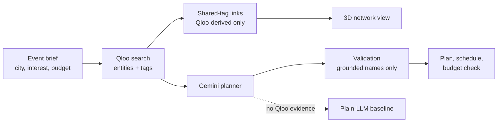

<div align="center">

# CultureMix

### Event concepts grounded in cultural data, checked against a budget.

[**Live demo**](https://culturemix-znjfvxu82zgogdpzegahmd.streamlit.app/) · [Qloo Agentic Hackathon 2026](https://qloo.devpost.com/) · [Report an issue](../../issues)

[](LICENSE)


</div>

---

<!-- Add screenshots to docs/ after you take them, then uncomment these lines:


-->

## Why CultureMix

Organisers choosing artists, food, and experiences for an audience usually work from popularity rankings. Those rankings don't show which things actually belong together culturally.

CultureMix starts from Qloo's cultural data. It shows which entities are linked by shared tags, builds a plan from those links, and labels every recommendation by its source: **Qloo-backed**, **mock**, or an **LLM hypothesis**. It never presents a guess as cultural evidence.

## Features

- **Qloo-grounded search.** Live entity search through the Qloo hackathon API, with names, IDs, and tags.
- **Connection network.** Entities that share a Qloo tag are linked, with the shared tags on each edge. Drawn as an interactive 3D view, with a 2D diagram alongside.
- **Grounded event plan.** Gemini drafts a concept and schedule. Its output is checked before display, and any recommendation marked as Qloo-backed must match a real Qloo result.
- **Budget check.** Planning estimates are totalled against your budget, with a breakdown and a remaining figure.
- **Plain-LLM comparison.** The same brief can be run with no Qloo evidence, shown side by side with the Qloo-informed plan.
- **Honest labelling.** Live Qloo data, mock data, and hypotheses are visually distinct throughout.

## How it works



## Qloo API usage

- Endpoint: `GET https://hackathon.api.qloo.com/search`
- Authentication: `X-Api-Key` header, read from the `QLOO_API_KEY` environment variable
- Fields used: `name`, `entity_id`, `types`, `tags`
- Entity types queried: artists by default; the interest field accepts any artist name

The key is never logged, displayed, or committed.

## Quick start

Requires Python 3.11 or newer.

```bash
git clone https://github.com/Unretur/Culturemix.git
cd Culturemix
python -m venv .venv
.venv\Scripts\activate          # Windows
# source .venv/bin/activate     # macOS / Linux
pip install -r requirements.txt
copy .env.example .env          # Windows
# cp .env.example .env          # macOS / Linux
```

Add your keys to `.env`:

```
QLOO_API_KEY=your_qloo_key
GEMINI_API_KEY=your_gemini_key
```

Run the app:

```bash
streamlit run src/app.py
```

Without keys, the app runs in mock mode and labels every result as mock.

## Tests

```bash
pytest tests/
```

The tests run offline. They cover budget arithmetic, plan validation, Qloo response normalisation, and the mock-labelling rules.

## Project structure

```
src/
  app.py          Streamlit interface
  planner.py      Plan building, validation, budget checks
  llm.py          Gemini client with retries
  qloo_client.py  Qloo API client and mock adapter
  connections.py  Shared-tag links between Qloo entities
  viz3d.py        3D network view (Three.js)
tests/            Offline unit tests
.streamlit/       Theme configuration
```

## Limitations

- Qloo search matches entity names, so the quality of results depends on the input. Artist names work best.
- Connections exist only where Qloo returns overlapping tags. Some searches show few or none.
- Costs are planning estimates, not vendor quotes.
- The plain-LLM comparison is shown in the app. It is not a benchmark with a scored test set.
- Gemini's free tier sometimes returns temporary "high demand" errors. Retry the request.
- The 3D view loads Three.js from unpkg and needs internet access. The 2D diagram works without it.

## Roadmap

- Shared-affinity queries across more Qloo entity types, once verified against the API.
- A fixed set of evaluation briefs with recorded results.
- Organiser-supplied vendor quotes in the budget check.

## Acknowledgements

Built on [Qloo](https://www.qloo.com/) for cultural intelligence data, [Streamlit](https://streamlit.io/) for the interface, [Google Gemini](https://ai.google.dev/) for plan drafting, and [Three.js](https://threejs.org/) for the 3D view.

## License

MIT. See [LICENSE](LICENSE).